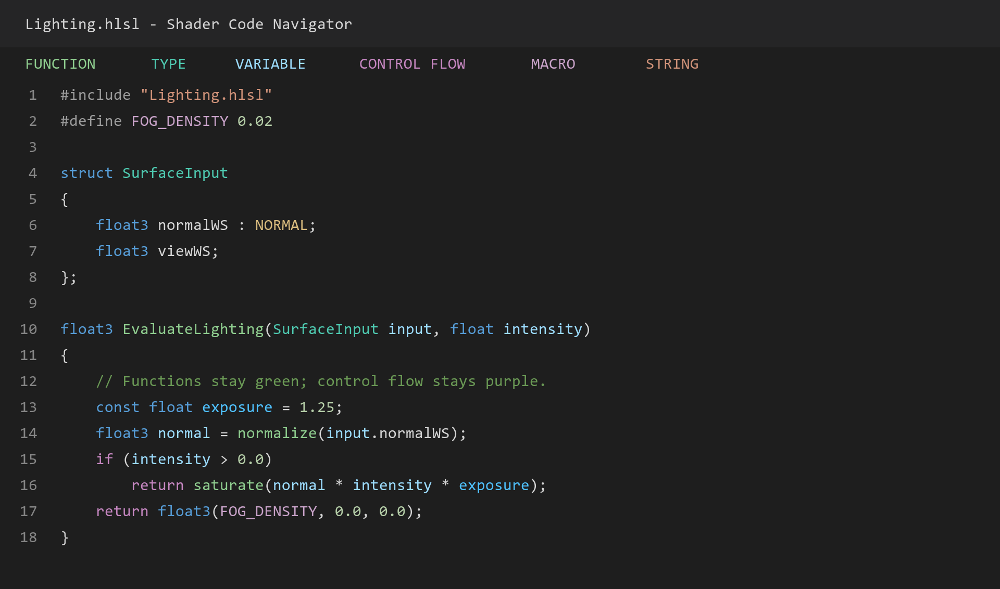

# Shader Code Navigator

独立的 VS Code ShaderLab / HLSL 语言辅助扩展。可用于任意文件夹，无 Unity 项目程序集或业务代码依赖。

Standalone ShaderLab / HLSL navigation and completion for Visual Studio Code. Compatible with the Unity extension's `UnityShader` language mode.

## 安装与使用

从 [GitHub Releases](https://github.com/lala-lzw/shader-code-navigator/releases/latest) 下载 `.vsix` 安装包。在 VS Code 扩展面板的 `…` 菜单选择 **从 VSIX 安装**，选择下载的文件。安装后打开 Shader 文件；已打开的窗口若未生效，执行 **Developer: Reload Window**。

已安装 Unity 官方扩展时，文件保持 `UnityShader` 语言模式即可，无需禁用其它扩展或改动项目配置。

- 输入部分函数名、变量名或类型名会出现候选；`Ctrl+Space` 手动触发，`Tab` / `Enter` 选择。
- `Ctrl+单击` / `F12` 跳转 include、函数、宏、结构体、字段、参数、局部变量和材质属性定义。
- 输入 `(`、`,` 显示参数提示；`Ctrl+Shift+Space` 手动触发。支持常用 HLSL 内建函数及工作区函数签名。
- `input.` 提示结构体成员，向量的 `.` 提示 `xyzw` / `rgba` 分量组合。
- 鼠标悬停显示声明；`Shift+F12` 查找引用，`F2` 重命名可明确解析的符号（请在 VS Code 中预览修改）。
- `Ctrl+Shift+O` 查看当前文件符号，`Ctrl+T` 搜索工作区符号。
- 命令 **Shader Navigator: Rebuild Index** 重新扫描。

支持 `.shader`、`.shaderlab`、`.hlsl`、`.hlsli`、`.cginc`、`.compute`、`.inc`，包括语法高亮、括号配对、注释与折叠。文件编辑后实时更新，包括尚未保存的内容。

## C# 风格配色

默认提供 Shader 专用语义配色，兼容 `shaderlab`、`hlsl` 和 Unity 官方扩展的 `UnityShader` 模式。函数声明与调用统一为绿色，结构体和资源类型为青色，变量与参数为浅蓝色；关键字蓝色、流程控制紫色、宏淡紫色、字符串橙色、注释暗绿色。浅色主题自动使用对应的深色字色，高对比度主题跟随主题设置。



配色依据源码符号和词法类别区分，`if/for/return` 不会当作函数；类型构造、注释、字符串和 include 路径也分别处理。只影响 Shader 文件，无需切换整个编辑器主题。

需要跟随当前主题的标准颜色时，设置 `shaderNavigator.highlighting.style` 为 `theme`；关闭额外语义着色可将 `shaderNavigator.highlighting.enabled` 设为 `false`。VS Code 中显式设置的 `editor.semanticHighlighting.enabled: false` 优先于扩展默认值。

函数颜色还可通过用户设置 `editor.semanticTokenColorCustomizations.rules.shaderFunction`（深色主题）和 `shaderFunctionLight`（浅色主题）自定义。

## include 路径

依次搜索：当前文件目录、打开的工作区根目录、配置的 include 目录，最后尝试工作区中唯一匹配的路径或文件名。支持递归 include、循环 include 和 `#include_with_pragmas`。补全和符号跳转按当前文件的 include 依赖链及局部作用域查找，避免其它 Shader 的同名函数混进候选。

在用户设置或任意工作区设置中配置；路径可以是绝对路径、相对工作区路径，或使用 `${workspaceFolder}`。工作区外的目录也会建立符号索引。

```json
{
  "shaderNavigator.includePaths": [
    "Shaders/Includes",
    "../SharedShaders"
  ]
}
```

Unity 内建 `CGIncludes`、额外 SDK 和工作区外的 Shader 库可通过该设置接入。不会写入固定 Unity 安装路径。外部目录文件在扩展中编辑时会更新，若由其它程序修改，请执行 Rebuild Index。

默认排除 `node_modules`、`Library`、`Temp`、`obj`、`bin`，可用 `shaderNavigator.exclude` 调整。扫描上限为 20000 个文件；状态栏数字后的 `+` 表示达到上限，可调整 `shaderNavigator.maxFiles`。

## 加载速度与进度

打开文件时先显示本文件的配色和符号列表，include 在后台加载。补全最多等待约 50 ms 获取依赖数据，随后先返回本文件与内建候选；继续输入时会使用已加载的 include 符号。首次跨文件跳转仍需等待对应依赖就绪。

同一会话内缓存解析结果、include 路径和依赖图；普通正文修改、切换文件与重新打开相同内容会复用缓存。修改 include 或创建、删除文件时自动更新依赖，避免沿用失效结果。工作区后台扫描采用小批次处理，优先服务当前文件。

状态栏显示发现文件、加载 include、工作区扫描的阶段和已完成/总数。超过约 350 ms 的任务会自动展开进度通知；点击状态栏或执行 **Shader Navigator: Show Loading Progress** 也能展开。工作区扫描可取消，当前文件继续可用；需要补全整个工作区索引时执行 **Rebuild Index**。

缓存保存在当前扩展会话的内存中，重启后首次加载仍需读取文件。**Diagnose Active File** 输出本会话解析次数、磁盘读取次数和缓存命中数，可用于排查异常重复加载。

## 当前边界

这是基于源码索引的语言辅助工具，未连接 Shader 编译器。它不执行条件宏分支求值、宏展开或完整 HLSL 类型检查，不报告编译错误。函数重载会列出可见实现；复杂模板、宏生成声明、方法返回值推导、数组访问后的成员链，以及完整 C/C++ 作用域语义不在当前支持范围。引用和重命名依赖同一套索引规则，复杂宏和重载场景请人工确认。

## 开发与验证

Node.js 18 或以上版本：

1. `npm ci`
2. `npm test`：TypeScript 编译和解析测试。
3. `npm run test:integration`：在独立临时工作区启动真实 VS Code 扩展宿主测试。可通过环境变量 `SHADER_TEST_CODE_EXE` 指定已有的 `Code.exe`，未指定时测试工具会下载 VS Code。
4. `npm run vsix`：生成可安装包。

直接打开本目录并按 `F5` 可运行开发扩展。入口为 `src/extension.ts`，源码解析为 `src/parser.ts`，include 和作用域索引为 `src/workspaceIndex.ts`。

集成测试覆盖原生 ShaderLab 和 Unity 扩展的 `UnityShader` 模式，包括自动激活、include 和精确符号跳转、重载候选、局部变量/参数/结构体字段、cbuffer、补全、外部 include 库、内建函数签名、悬停、引用、重命名、文档符号、向量分量及未保存文本更新。

## 0.1.3 更新

优先加载当前文件，配色与符号列表不再等待 include 链；增加会话缓存和合并文件读取，正文编辑不再重复遍历依赖。优化行号和括号作用域计算，并加入分阶段进度、状态栏计数与后台扫描取消。

约 4 万字符、400 个函数的合成文件，5 次测量的解析中位耗时从约 70 ms 降到 4.5 ms，符号结果一致；这反映解析器开销，实际打开时间还取决于文件规模、磁盘和其它扩展。可用 `npm run benchmark:parser -- v0.1.2` 对比该版本（本地需存在相应 Git tag）。

## 0.1.2 更新

新增 C# 风格语义着色、深浅两套调色板和跟随主题模式；修正关键词被当作函数、矩阵类型不完整、宏与普通大写变量混色等问题。增加语义分类、TextMate 规则和真实 VS Code 配色测试，并保留原有补全与跳转能力。

## 0.1.1 修复

兼容 Unity 官方扩展的 `UnityShader` 语言 ID 和其它扩展的文件关联；后台扫描前先注册语言服务；支持带前导 `/` 的虚拟根 include 路径。

执行 **Shader Navigator: Diagnose Active File**，可在 Output > Shader Code Navigator 查看激活状态、实际语言模式和 include 解析结果。

## 许可证

[MIT](LICENSE)。
